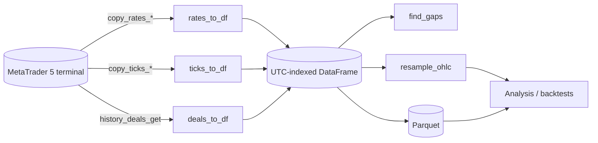

# mt5-data-fmt

[](https://github.com/sergiogoqui-cpu/mt5-data-fmt/actions/workflows/ci.yml)


Tidy, **UTC-correct** pandas DataFrames from the MetaTrader 5 Python API. It converts `copy_rates_*`, `copy_ticks_*` and `history_deals_get` results, fixes the broker-time pitfall, decodes tick flags and deal types, resamples bars, finds gaps and saves Parquet.

It does **not** import `MetaTrader5`: it works on the arrays and tuples that library returns, so you can develop and test on any OS (including Linux CI).

```python
import MetaTrader5 as mt5
from mt5_data_fmt import rates_to_df, resample_ohlc

mt5.initialize()
raw = mt5.copy_rates_from_pos("EURUSD", mt5.TIMEFRAME_M5, 0, 5000)

bars = rates_to_df(raw, server_utc_offset_hours=3)   # real UTC index
hourly = resample_ohlc(bars, "1h")
```

## Why

| Pitfall in raw MT5 data | What this does |
|---|---|
| Timestamps are **broker server time encoded as UTC** | `server_utc_offset_hours` shifts to real UTC; the index is tz-aware |
| Tick `flags` are a bitmask | Decoded into `is_bid`, `is_ask`, `is_trade`, `is_buy`, `is_sell` |
| Deals use numeric `type`/`entry` codes | Readable `type_name` (BUY, SELL, BALANCE...) and `entry_name` (IN, OUT...) |
| Profit is spread over four columns | `net_profit` = profit + commission + swap + fee |
| Duplicate / unordered bars after merging requests | De-duplicated and sorted |
| Different datetime resolution across pandas versions | Index pinned to nanoseconds (stable Parquet round-trip) |
| Silent holes in history | `find_gaps()` reports every missing stretch |
| Heavy tick files | `as_float32()` and zstd Parquet helpers |

## How it fits in



## Install

```bash
pip install git+https://github.com/sergiogoqui-cpu/mt5-data-fmt.git
```

The MetaTrader 5 terminal and `pip install MetaTrader5` are only needed to *fetch* data (Windows). Converting and analysing works anywhere.

## Usage

### The broker time offset

Most brokers run server time at UTC+2 (winter) / UTC+3 (summer). Check yours by comparing `mt5.symbol_info_tick(sym).time` with the real UTC clock, then pass the matching offset. Daylight saving changes the offset, so for long histories convert per segment.

### Ticks with decoded flags

```python
from mt5_data_fmt import ticks_to_df

ticks = ticks_to_df(mt5.copy_ticks_range("EURUSD", t0, t1, mt5.COPY_TICKS_ALL), server_utc_offset_hours=3)
ticks[ticks.is_trade & ticks.is_buy]
```

### Deals and net profit

```python
from mt5_data_fmt import deals_to_df

deals = deals_to_df(mt5.history_deals_get(t0, t1), server_utc_offset_hours=3)
closed = deals[deals.entry_name == "OUT"]
closed.groupby("symbol")["net_profit"].sum()
```

### Find holes before you trust a backtest

```python
from mt5_data_fmt import find_gaps

find_gaps(bars, "5min")           # DataFrame: start, end, missing
```

Weekends and holidays appear as gaps; filter them to your market calendar.

### Save and load

```python
from mt5_data_fmt import to_parquet, read_parquet

to_parquet(bars, "eurusd_m5.parquet")      # zstd, UTC index preserved
bars = read_parquet("eurusd_m5.parquet")
```

## API

| Function | Purpose |
|---|---|
| `rates_to_df(rates, server_utc_offset_hours=0)` | OHLCV bars, UTC bar-open index |
| `ticks_to_df(ticks, server_utc_offset_hours=0)` | Millisecond ticks with decoded flags |
| `deals_to_df(deals, server_utc_offset_hours=0)` | Deal history with names and `net_profit` |
| `resample_ohlc(df, rule)` | Aggregate to a larger timeframe |
| `find_gaps(df, freq, tolerance=0)` | Missing-bar report |
| `to_parquet(df, path)` / `read_parquet(path)` | Round-trip storage |
| `as_float32(df)` | Downcast float columns |
| `DEAL_TYPES`, `DEAL_ENTRIES` | Code-to-name maps |

## Development

```bash
pip install -e . pytest
pytest
```

## License

MIT. Issues and pull requests are welcome.
